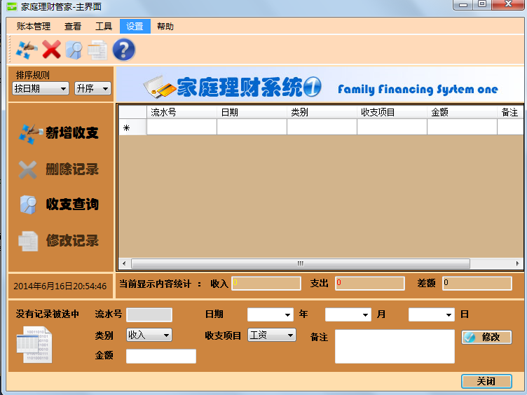
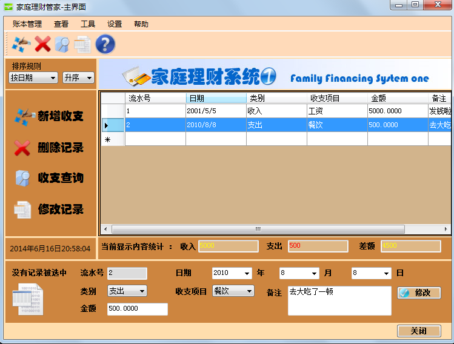
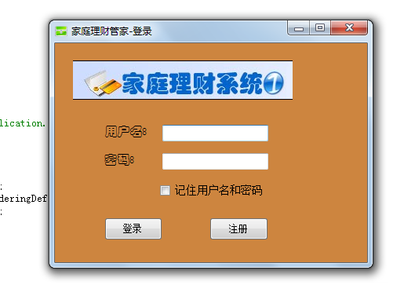
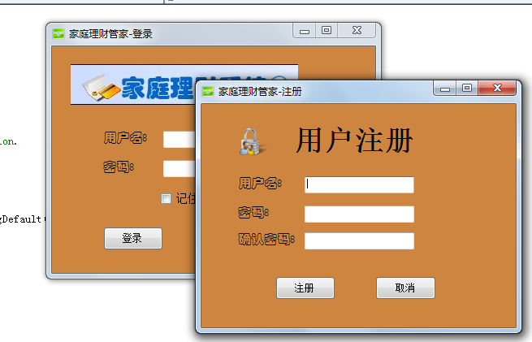
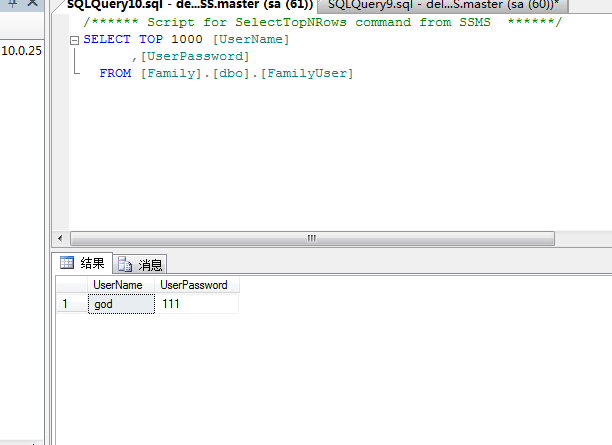

# FamilyFinancePro

A family-finance application built as a Windows Forms learning project. It uses SQL Server for its data and includes forms for signing in, registering users, and managing financial records.

## Getting start

Open [FamilyFinancePro/FamilyFinancePro.sln](FamilyFinancePro/FamilyFinancePro.sln) in Visual Studio to inspect the source. The application depends on SQL Server; this repository does not provide a packaged, ready-to-run executable.

## Unfinished

The project is unfinished. The screenshots below show individual features that were developed, rather than a complete application you can run as a demo. Further implementation is needed to turn the exercises into usable family-finance software.

## Demo

Screenshots of the implemented screens and operations:

1. Main ui

  

2. CRUD (create, read, update, and delete records)

  

3. Login UI

  

4. Auth

  

5. Register

  

6. Records stored in SQL Server

  

## Thanks

By the way, when I was newbie that starting .net winform, I usually find more resouce from internet to help me and some of those res is video.

When you want to learn sth as first, you must need know how to mock and copy, this skill could help you make progress step by step.
